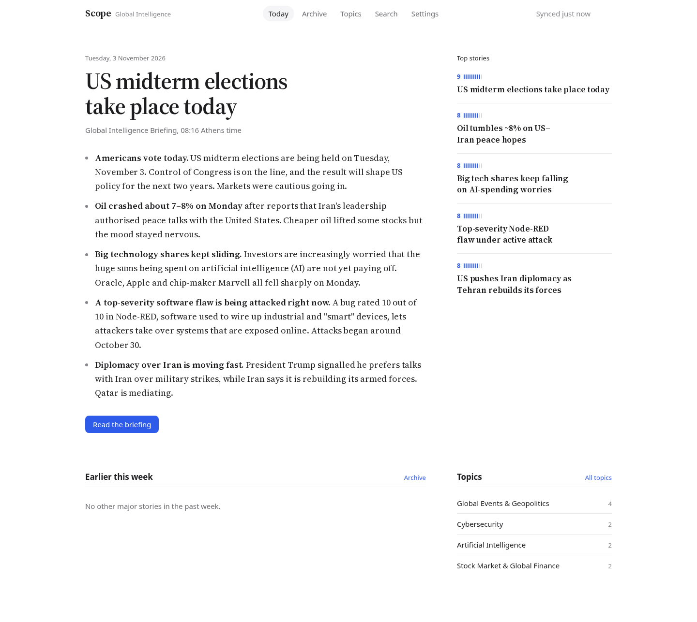
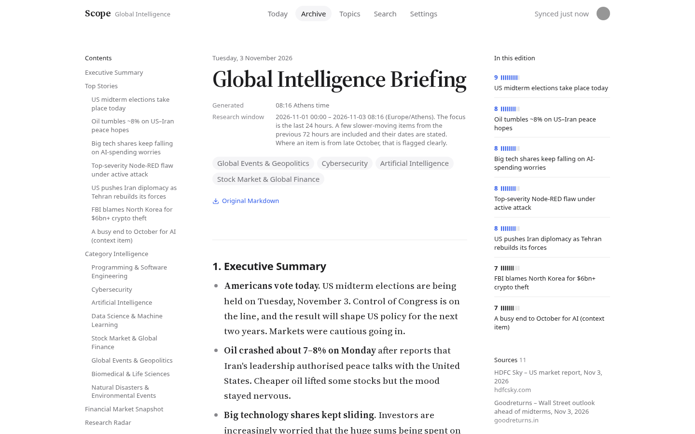
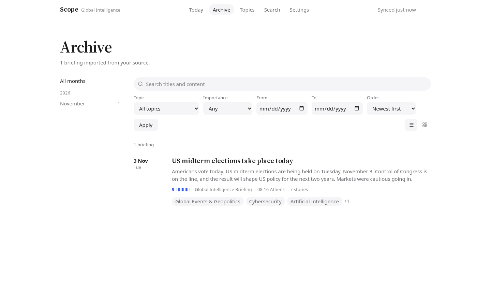
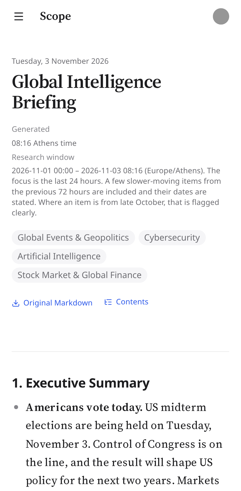
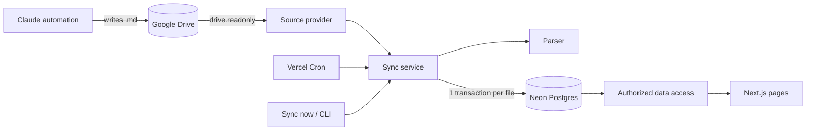

# Scope

**A personal intelligence newsroom.** Scope imports the daily Markdown dossiers that a scheduled Claude research automation saves to Google Drive, and turns them into a calm, searchable reading experience: today's briefing first, every story by topic, the whole archive one search away.



| Reading view | Archive | Mobile |
|---|---|---|
|  |  |  |

- **Read-only by construction.** Scope requests only `drive.readonly`, reads a folder shared with it as Viewer, and its Drive module can only list and download. Tests enforce this.
- **Never loses a report.** The original Markdown is stored verbatim. Structured extraction (stories, topics, metadata) is best-effort and re-runnable; the full report always renders.
- **Works with your automation, not just mine.** Topics, report titles, section names and folder layout are all configuration. The parser reads label structure (`**Category:** ...`), not fixed headings.

---

## Contents

1. [What it does](#what-it-does)
2. [How it works](#how-it-works)
3. [Technology](#technology)
4. [Prerequisites](#prerequisites)
5. [Install](#install)
6. [Create the Neon database](#create-the-neon-database)
7. [Configure Clerk](#configure-clerk)
8. [Configure Google Drive access](#configure-google-drive-access)
9. [The Drive folder structure](#the-drive-folder-structure)
10. [Environment variables](#environment-variables)
11. [Run migrations](#run-migrations)
12. [Run locally](#run-locally)
13. [Import your first report](#import-your-first-report)
14. [Scheduled synchronization](#scheduled-synchronization)
15. [Deploy on Vercel](#deploy-on-vercel)
16. [Use a different research automation](#use-a-different-research-automation)
17. [Customize topics and report formats](#customize-topics-and-report-formats)
18. [Troubleshooting](#troubleshooting)
19. [Development](#development)

---

## What it does

| Page | What you get |
|---|---|
| **Today** | The latest edition, headlined by its most important story, with the executive summary, top stories, the week's major stories, topics and earlier editions. |
| **Reading view** | The full original report set for long-form reading: sticky contents, story rail with importance, source list, same-day editions, reading progress, link to the file in Drive, raw Markdown download. |
| **Archive** | Every edition, with full-text search, topic, importance and date filters, newest/oldest order, list or grid, and year/month navigation. Several editions on the same day are grouped. |
| **Topics** | Each research area with story counts, last activity, its latest stories and its latest per-topic brief. |
| **Search** | PostgreSQL full-text search across briefings, stories and topics with highlighted matches. |
| **Settings** | Admins only. Newsroom details, topic editor (with aliases and "unmapped categories" from your reports), Google Drive connection, sync now, re-process, sync history, account. |

### Who can do what

A deployment is one publication. The people listed in `ADMIN_EMAILS` run it; everyone else who signs up is a reader.

| | Admin (email in `ADMIN_EMAILS`) | Reader (any other signed-in account) |
|---|---|---|
| Read Today, Archive, reports, Topics, Search, raw Markdown | yes | yes |
| Create a newsroom, connect Drive, edit topics, sync, Settings | yes, for newsrooms they own | no (Settings returns 404) |

Signed-out visitors see a short introduction and must sign in to read. Want your own newsroom, with your own folder and topics? Clone the repository and deploy your copy with your email in `ADMIN_EMAILS`.

## How it works



1. **Discovery.** The sync lists the configured Drive folder recursively and compares each file's checksum with what is stored. Unchanged files are never downloaded.
2. **Parsing.** New and changed files are parsed deterministically (no LLM): metadata, sections, stories, topics, source links. Anything unrecognized is kept in the original Markdown and noted as an import warning.
3. **Persistence.** Each file is written in one transaction, keyed by `(newsroom, Drive file ID)`, so re-running is always safe.
4. **Reading.** Pages read only from Neon. Drive can be offline without affecting the app.

The full design, including the database schema, sync algorithm, authorization model and the decisions behind them, is in [docs/architecture.md](docs/architecture.md).

## Technology

| Area | Choice |
|---|---|
| Framework | Next.js 16 (App Router, Server Components, Server Actions), React 19, TypeScript (strict) |
| UI | Tailwind CSS 4, Base UI primitives in the shadcn/ui pattern, Lucide icons, react-markdown + remark-gfm |
| Data | Neon PostgreSQL, Drizzle ORM and migrations, PostgreSQL full-text search |
| Auth | Clerk |
| Integration | Google Drive API v3 via a read-only service account |
| Hosting | Vercel (functions + cron) |
| Quality | Vitest (unit + PGlite integration), Playwright (end-to-end), ESLint, Prettier |

## Prerequisites

- Node.js 22 or newer and npm.
- A [Neon](https://neon.tech) account (the free plan is enough).
- A [Clerk](https://clerk.com) account.
- A Google account with Google Drive, and access to the [Google Cloud console](https://console.cloud.google.com).
- Optional: a [Vercel](https://vercel.com) account for deployment.
- A research automation that saves Markdown files to Drive. To build the one Scope was designed around, follow the reference guide that came with it (a Claude project with instructions, a connected Drive, and a daily routine).

## Install

```bash
git clone https://github.com/<you>/scope.git
cd scope
npm install
cp .env.example .env.local
```

## Create the Neon database

1. In the Neon console, create a project. Pick the region closest to where you will deploy (the default `vercel.json` uses Vercel's Frankfurt region, `fra1`, which matches Neon's `eu-central-1`).
2. Open **Connect** and copy two connection strings:
   - the **pooled** one (host contains `-pooler`) into `DATABASE_URL`;
   - the **direct** one into `DATABASE_URL_UNPOOLED` (used for migrations).
3. Recommended: keep development data out of production. Local development and the e2e tests (which create a test user, newsroom and source) read `.env.local`, so point it at a separate database. Either:
   - create a `dev` branch in the Neon console and use its connection strings locally; or
   - create a second database on the same branch, with no extra compute, then change only the database name (the path after the host) in both local strings:

     ```bash
     psql "<direct URL>" -c "create database scope_dev"
     ```

   Run `npm run db:migrate` once against each database. Production keeps the original strings, which you set in Vercel.

Only Postgres is needed. Scope stores text only and does not use object storage.

## Configure Clerk

1. In the Clerk dashboard, create an application. Any sign-in method works (email, Google, passkeys).
2. Copy the publishable and secret keys into `NEXT_PUBLIC_CLERK_PUBLISHABLE_KEY` and `CLERK_SECRET_KEY`.
3. Put your own email in `ADMIN_EMAILS` (see [Who can do what](#who-can-do-what)). Anyone else who signs up can read, not edit. To limit who can read, use Clerk's sign-up restrictions (allowlist).

## Configure Google Drive access

Scope uses a Google Cloud **service account** with the `drive.readonly` scope. You share your report folder with it as Viewer. Step-by-step instructions, including how to encode the key, are in **[docs/google-drive-setup.md](docs/google-drive-setup.md)**.

Why a service account rather than "Sign in with Google": Google's OAuth refresh tokens for apps in Testing status expire after 7 days, and `drive.readonly` is a restricted scope requiring a security review for published apps. A service account works unattended on a schedule, stores no tokens in the database, and can only see what you explicitly share with it.

## The Drive folder structure

Scope reads every `.md` file below the folder you connect, at any depth (up to 6 levels). The reference automation uses:

```
Global Intelligence Briefing/          <- connect this folder
  2026/
    11-November/
      2026-11-03_0816_Global_Intelligence_Briefing.md
      2026-11-04_0816_Global_Intelligence_Briefing.md
```

Folder names carry no meaning to Scope. Dates come from the report content, then from a `YYYY-MM-DD_HHMM_` file-name prefix, then from Drive's creation time. Files are identified by their Drive ID, so moving or renaming a file updates it instead of duplicating it. Google Docs, shortcuts and files over 2 MB are skipped.

## Environment variables

Every variable is documented in [`.env.example`](.env.example).

| Variable | Required | Purpose |
|---|---|---|
| `DATABASE_URL` | yes | Neon pooled connection string |
| `DATABASE_URL_UNPOOLED` | for migrations | Neon direct connection string |
| `NEXT_PUBLIC_CLERK_PUBLISHABLE_KEY`, `CLERK_SECRET_KEY` | yes | Clerk keys |
| `NEXT_PUBLIC_CLERK_SIGN_IN_URL`, `NEXT_PUBLIC_CLERK_SIGN_UP_URL` | no | Default `/sign-in`, `/sign-up` |
| `ADMIN_EMAILS` | yes, to set up | Comma-separated emails of the admins. Matched against verified Clerk emails, case-insensitively. Empty means nobody can create or edit a newsroom. |
| `GOOGLE_SERVICE_ACCOUNT_KEY` | for Drive | Base64 of the service account JSON key |
| `CRON_SECRET` | in production | Protects the scheduled sync endpoint |
| `SYNC_TIME_BUDGET_MS` | no | Import time per run, default 240000 |
| `ENABLE_FILESYSTEM_SOURCE`, `FILESYSTEM_SOURCE_ROOT` | no | Development only: read reports from a local folder |

Only `NEXT_PUBLIC_CLERK_PUBLISHABLE_KEY` reaches the browser. Everything else is read on the server and validated on first use, with an error that names the missing variable.

## Run migrations

```bash
npm run db:migrate
```

This applies the SQL in [`drizzle/`](drizzle) to the database in `DATABASE_URL_UNPOOLED` (or `DATABASE_URL`). After changing `src/server/db/schema.ts`, generate a new migration with `npm run db:generate`.

## Run locally

```bash
npm run dev
```

Open <http://localhost:3000>, create an account with an email listed in `ADMIN_EMAILS`, and follow the setup steps:

1. **Create your newsroom**: name, time zone, and optionally the suggested topics.
2. **Connect your Google Drive folder**: share it with the service-account email shown on screen, paste the folder link, **Check** (shows the folder name and how many Markdown files Scope can see), then **Connect**.
3. **Choose your topics**: keep, rename or replace the suggestions.
4. **Import your briefings**: press **Sync now**.

No Google setup yet? Set `ENABLE_FILESYSTEM_SOURCE=true` and `FILESYSTEM_SOURCE_ROOT=./fixtures/reports` in `.env.local` and choose **Local folder** in step 2 to try Scope with the bundled sample dossier.

## Import your first report

Any of these runs the same idempotent synchronization:

- **Settings > Google Drive > Sync now** in the app.
- **`npm run sync`** from the command line: every enabled source, or `npm run sync -- --newsroom <slug>` for one newsroom. There is no time limit here, so this is also the way to backfill a large archive.
- **`curl -H "Authorization: Bearer $CRON_SECRET" http://localhost:3000/api/cron/sync`**, exactly as Vercel's scheduler calls it.

Each run is listed under **Settings > Sync history** with counts and per-file errors. Running it twice imports nothing the second time.

To check Drive access without touching the database (lists the folder, downloads and parses every file, prints what was recognized):

```bash
npx tsx --conditions=react-server --env-file=.env.local scripts/dev/drive-check.ts "<folder link or ID>"
```

## Scheduled synchronization

`vercel.json` schedules `/api/cron/sync` on weekdays:

```json
{ "path": "/api/cron/sync", "schedule": "0 7 * * 1-5" }
```

- Schedules are in **UTC**. `0 7 * * 1-5` runs between 07:00 and 07:59 UTC on the Hobby plan (Vercel picks a time within the hour), which is after an automation that writes at about 08:00-09:00 Athens time.
- **Hobby** allows schedules that run at most once a day. **Pro** allows more frequent schedules, for example hourly on weekdays: `0 * * * 1-5`.
- Change the expression and redeploy to change the schedule. Pause a newsroom's scheduled sync without redeploying with the **Scheduled sync** switch in Settings.

| Automation runs at | Suggested schedule (UTC) |
|---|---|
| 08:00 Europe/Athens (UTC+2 winter) | `0 7 * * 1-5` |
| 07:00 America/New_York (UTC-5 winter) | `0 13 * * 1-5` |
| 08:00 Asia/Tokyo (UTC+9) | `0 0 * * 1-5` |

The sync is safe against the platform's realities: Vercel may skip or occasionally duplicate a cron delivery, and runs can overlap. A per-source lease lets only one run work at a time, every run catches up on everything outstanding, and a run that hits the time budget (`SYNC_TIME_BUDGET_MS`, below the 300 s function limit) stops cleanly and the next run continues. It never assumes the automation has finished: a file that appears later, or is rewritten, is picked up on the next run.

## Deploy on Vercel

1. Push your fork to GitHub and **import** it in Vercel (framework: Next.js).
2. Add the environment variables from the table above in **Project Settings > Environment Variables** (do not set `ENABLE_FILESYSTEM_SOURCE`). Set `ADMIN_EMAILS` to your own email and generate a fresh `CRON_SECRET`.
3. Set `"regions"` in `vercel.json` to the region nearest your Neon database.
4. Run migrations against the production database from your machine: `DATABASE_URL_UNPOOLED=<production direct URL> npm run db:migrate`. Migrations are deliberately not part of the build, so preview deployments can never change the production schema.
5. Deploy. Vercel registers the cron job from `vercel.json` automatically.
6. For a real production deployment, create a Clerk **production instance** for your domain and use its keys. Development keys work on `*.vercel.app` but have usage limits.

## Use a different research automation

Scope works with any process that saves Markdown files to a Drive folder. For the best extraction:

- **Start with a title** (`# My Daily Briefing`) and, optionally, a metadata block:
  ```markdown
  **Date:** 2026-11-03
  **Generated:** 08:16 (Europe/Athens)
  **Research window:** 2026-11-02 08:00 – 2026-11-03 08:00 (Europe/Athens)
  ```
  YAML frontmatter works too: `title`, `date`, `generated` (ISO timestamp), `timezone`, `topics`.
- **Write stories as a heading followed by labelled bullets.** Any heading level and any section name work:
  ```markdown
  #### Central bank holds rates
  - **Category:** Markets / Economy
  - **Importance:** 8/10
  - **What happened:** ...
  - **Why it matters:** ...
  - **What to watch next:** ...
  - **Sources:** [Reuters](https://...)
  ```
  Recognized labels include Category/Area/Topic, Importance/Score/Priority (`8/10`, `8`, `4/5`, or High/Medium/Low), What happened/Summary, Why it matters, Implications, What to watch/monitor, Event date/Published/Reported, Confidence and Sources. Several labels may share one line (`**Category:** X · **Importance:** 8/10`). Other labels are kept as extra fields.
- **Name files `YYYY-MM-DD_HHMM_Name.md`** if you can; it is the fallback when a report has no date.

Reports that follow none of this still import and render in full; they simply have fewer structured stories.

## Customize topics and report formats

- **Topics** live in the database, per newsroom: **Settings > Topics**. A story joins a topic when its category (or one half of an "X & Y" category) matches the topic's name, an alias, or one half of an "X & Y" name, so `Stock Market & Global Finance / Geopolitics` counts for both topics. **Unmapped categories** lists what your reports use that matches nothing yet, with one-click "Add as topic" or "Add as alias". Changes re-link stored reports automatically.
- **Suggested topics** for new newsrooms are in [`src/core/topics/defaults.ts`](src/core/topics/defaults.ts). Nothing else depends on them.
- **Parsing rules** are in [`src/core/parser`](src/core/parser): label vocabulary in `labels.ts`, section kinds in `sections.ts`. After changing the parser, bump `PARSER_VERSION` in `src/core/parser/index.ts`; the next sync re-parses stored reports without downloading them (or run `npm run reprocess`, or **Settings > Re-process all briefings**).

## Troubleshooting

| Symptom | Fix |
|---|---|
| "The folder was not found, or is not shared with the service account" | Share the folder (not a file) with the service-account email as Viewer, and check the link. |
| "This folder is owned by a different Google account" | Scope binds a Drive folder only for a user whose verified sign-in email owns it. Add that email to your Clerk account, or sign in with it. |
| "This folder is already connected to another newsroom" | A folder can feed one newsroom per deployment. Connect a different folder in the other newsroom first. |
| "Google Drive access is not configured" | Set `GOOGLE_SERVICE_ACCOUNT_KEY` (base64 of the JSON key) and restart or redeploy. |
| Service-account key creation is blocked | Your Google Workspace organization forbids keys. See [docs/google-drive-setup.md](docs/google-drive-setup.md). |
| A sync says "Partial" | Some files failed or the time budget was reached. Details are in Sync history; the next run continues. |
| A run shows "Interrupted" | The function was stopped mid-run (timeout or deploy). The lock is released automatically after 15 minutes. |
| Stories are missing or categories are not linked | Check the report's import notes on its page and **Settings > Topics > Unmapped categories**. |
| Scheduled sync never runs | Cron jobs run only on production deployments. Check `CRON_SECRET` and Vercel's Cron Jobs page and logs. |
| `Invalid database environment configuration` | `DATABASE_URL` is missing or malformed. |

## Development

```bash
npm run dev            # dev server
npm run check          # lint + typecheck + unit/integration tests + format check
npm run test           # Vitest: parser, sync, data access and authorization (PGlite, no network)
npm run test:e2e       # Playwright: signs in a Clerk test user and walks every page
npm run build          # production build
```

`npm run test:e2e` needs a filled `.env.local` with `ENABLE_FILESYSTEM_SOURCE=true`. It creates a Clerk test user (`scope-e2e+clerk_test@example.com`) in your development instance and a newsroom fed from `fixtures/reports`, and saves screenshots to `test-results/screens/`. To refresh the README images, copy the ones you want into `docs/screenshots/`.

### Project structure

```
src/
  app/                 routes: landing, onboarding, /n/[newsroom]/..., cron route
  components/          ui/ primitives, newsroom/, markdown/, settings/
  core/                pure logic: parser, topic matching, time, hashing
  server/
    auth/              session, admin role and newsroom access (the only source of AuthorizedNewsroom)
    data/              every query, scoped to an authorized newsroom
    db/                Drizzle schema and clients
    sources/           read-only Google Drive and dev filesystem providers
    sync/              synchronization, lease, persistence, re-processing
    actions/           Server Actions (validated with Zod)
drizzle/               SQL migrations
fixtures/reports/      the real sample dossier (also the dev filesystem source)
tests/                 unit, integration (PGlite) and e2e (Playwright)
docs/                  architecture, Google setup, screenshots
```

### Security model

- Authorization is checked on the server for every page, Server Action and route. Data functions only accept an `AuthorizedNewsroom`, a type that can only be produced by an access check, so an unscoped query does not compile.
- Any signed-in user may read. Every change goes through `authorizeNewsroomAction`, which requires the newsroom's owner to still be an admin; removing an email from `ADMIN_EMAILS` revokes editing at once. Settings and setup pages return 404 to readers.
- Drive access is read-only three ways: scope, Viewer sharing, and a code surface with no write calls (tested).
- Report Markdown is rendered without raw HTML, with sanitized URLs and `rel="noopener noreferrer"` on external links.
- One service account serves a deployment. A folder binds to one newsroom only, and only for an admin whose verified email owns it.
