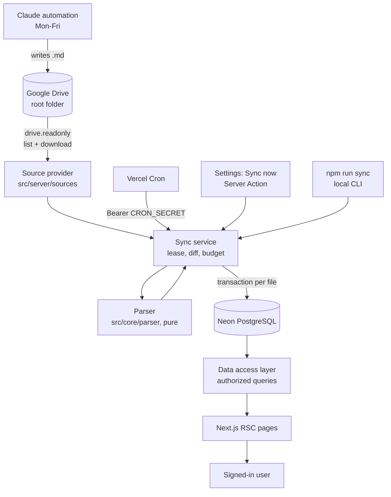
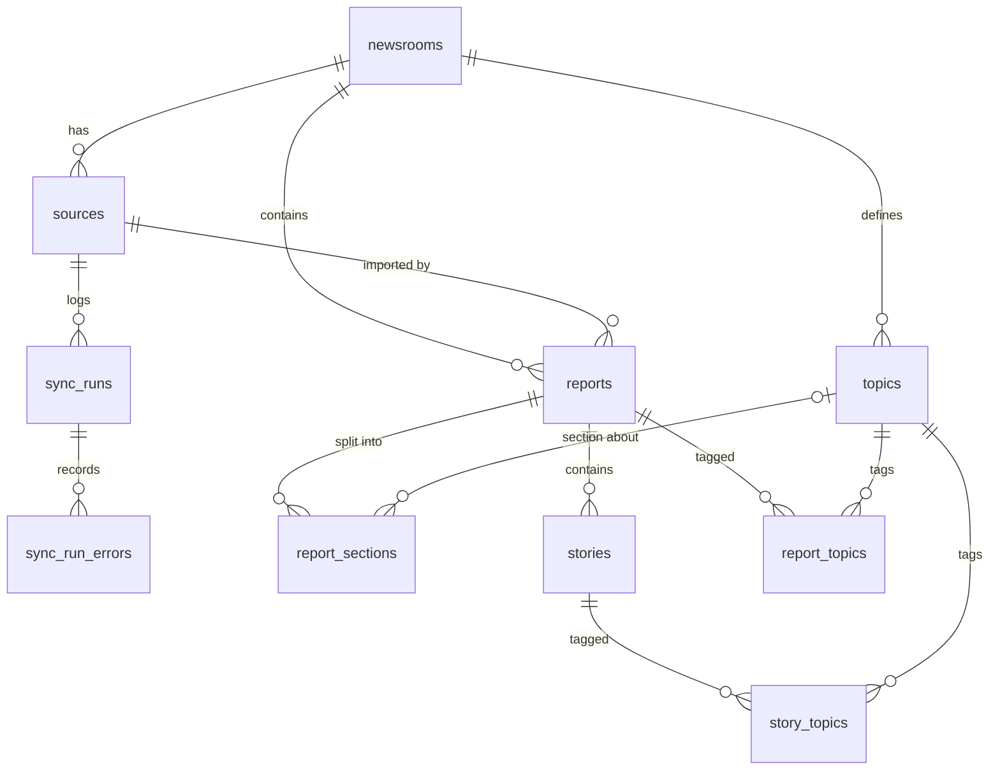

# Scope: Architecture and Implementation Plan

Status: **Approved 2026-11-03.** Decisions: service account for Drive; same-day editions shown grouped by day with the latest featured; git commit per milestone; dev-only local folder source included.
Date of research: 2026-11-03. Version numbers and platform limits are "as of" that date.

Scope is a personal intelligence newsroom. An external Claude automation writes a Markdown dossier to Google Drive every weekday. Scope imports those files (read-only), normalizes them into Neon PostgreSQL, and presents them as an editorial reading experience behind Clerk authentication.

---

## 0. Phase 1 findings

### 0.1 What the automation actually produces

Sources read: `README_replicate_automation.md`, `2026-11-03_0816_Global_Intelligence_Briefing.md`, plus a read-only look at the live Drive folder (metadata of 3 files and the content of the 2026-11-02 10:07 edition) to check for format drift.

| Fact | Evidence | Design consequence |
|---|---|---|
| Files are stored as `text/markdown`, extension `.md`, ~20 KB each | Drive metadata | Discovery filters on `.md` extension or `text/markdown` / `text/x-markdown` MIME type. Content is downloaded with `files.get?alt=media`. |
| Drive provides `md5Checksum`, `modifiedTime`, `createdTime`, `parents` for these files | Drive metadata | Cheap change detection without downloading. |
| **More than one edition per day exists** (2026-11-02 at 10:07 and 10:34) | Drive listing | `report_date` is not unique. Uniqueness is the Drive file ID. The UI groups editions by day. |
| Folder layout: `<Root>/<YYYY>/<MM-Month>/<YYYY-MM-DD_HHMM_Name>.md`; the actual root is named `Global Intelligence Briefing` (not `... Briefing/` as in the README template) | Drive listing, README | Recursive discovery from a configured root folder ID. Folder names are never parsed for meaning; dates come from content, then filename, then Drive timestamps. |
| `Generated: 08:16` but the file was created at 06:22 UTC (08:22 Athens) | Drive metadata vs content | Display the content's generation time; keep Drive times as source metadata only. |
| The template is followed loosely; the structure drifts between runs | Comparison of 11-02 and 11-03 editions (table below) | Parser must be label-driven and heading-agnostic, never position- or exact-heading-driven. |

### 0.2 Format drift observed between two consecutive editions

| Element | 2026-11-03 08:16 | 2026-11-02 10:07 |
|---|---|---|
| Story category and importance | Separate bullets: `**Category:** X` / `**Importance:** 8/10` | One bullet: `**Category:** X · **Importance:** 9/10` |
| Story date label | `Event date:`, `Event dates:`, inline `**Reported:**` | `Published/Event:`, `Event:` |
| Confidence | Not present | `**Confidence:** *Medium* ...` per story, `*(High)*` inline in summary bullets |
| Story sources | Markdown links | Often plain outlet names, no URLs |
| Extra story fields | `Fix:`, `Note:` | `Implications (financial/technical):` |
| Category sub-headings | `#### Cybersecurity` | `#### 3.2 Cybersecurity` (numbered) |
| Category values | Compound: `Stock Market & Global Finance / Geopolitics` | Abbreviated: `AI / Finance` |
| Risk monitor | Bold labels + bullet lists | A Markdown table |
| Preamble | None | A blockquote "Verification note" before section 1 |
| Research window | Window plus a trailing explanatory paragraph | Window plus `; extended to ~2026-10-19 ...` |
| Typography | `–` en dash in ranges, `−` minus signs, `~` approximations | Same |

Edge cases to handle beyond these: CRLF line endings, UTF-8 BOM, a missing H1, missing metadata block, YAML frontmatter (other automations), H2 instead of H3 sections, stories not under a "Top Stories" heading, importance written as words ("High"), empty or truncated files (failed automation runs), non-report `.md` files in the folder (for example a README), very large files, files moved between folders, renamed files, deleted or trashed files, and shortcuts.

### 0.3 Platform constraints verified

| Topic | Verified fact (source) | Consequence |
|---|---|---|
| Next.js | Latest stable `16.4.4`. In v16 `middleware.ts` is renamed `proxy.ts`; proxy runs on the Node.js runtime only. ([Next.js 16 upgrade guide](https://github.com/vercel/next.js/blob/canary/docs/01-app/02-guides/upgrading/version-16.mdx)) | Clerk is wired through `proxy.ts`. |
| Clerk | `@clerk/nextjs` `7.9.23`, peer `next ^16.1`, `react ~19.3`. `clerkMiddleware()` + `createRouteMatcher()` + `auth.protect()` in `proxy.ts`; `auth.protect()` inside Server Actions returns 401. ([Clerk docs](https://github.com/clerk/clerk-docs)) | Compatible with Next 16.4. Component-level API details are re-checked at implementation time. |
| Drizzle | Stable `drizzle-orm 0.45.4`, `drizzle-kit 0.31.11`. `1.0.0` is still RC. | Use 0.45.x stable. |
| Neon driver | `@neondatabase/serverless 1.2.0`. HTTP is the default and is fastest for single queries; HTTP transactions are **non-interactive only**. Interactive transactions need the WebSocket `Pool`, which on Vercel should be created, used and closed inside the handler. Node 22+ has a built-in `WebSocket`. ([Neon serverless driver](https://neon.com/docs/serverless/serverless-driver), [Drizzle + Neon](https://orm.drizzle.team/docs/connect-neon)) | Reads use `neon-http`. Ingestion writes use a short-lived `Pool` for real transactions. |
| Vercel Cron | Hobby: once per day minimum, invoked anywhere within the scheduled hour. Pro: per minute. Schedules are UTC, defined in `vercel.json`. `CRON_SECRET` is sent as `Authorization: Bearer <secret>`. No retries on failure. Delivery is best-effort and can occasionally **duplicate** an invocation. Overlapping runs are possible. ([Usage and pricing](https://vercel.com/docs/cron-jobs/usage-and-pricing), [Managing cron jobs](https://vercel.com/docs/cron-jobs/manage-cron-jobs)) | Lease-based concurrency guard, idempotent upserts, reconciliation (each run catches up everything outstanding). |
| Region | The Neon database lives in AWS `eu-central-1` (Frankfurt); Vercel's default function region is `iad1`. | `vercel.json` sets `"regions": ["fra1"]` so every query does not cross the Atlantic. |
| Vercel Functions | Fluid compute max duration: Hobby 300 s; Pro 300 s default, 800 s max. ([Function limits](https://vercel.com/docs/functions/limitations)) | Sync has a time budget and resumes on the next run. |
| Google OAuth (user consent) | Apps in "Testing" status get refresh tokens that **expire after 7 days**. ([Google OAuth 2.0](https://developers.google.com/identity/protocols/oauth2)) `drive.readonly` and `drive.metadata.readonly` are **restricted** scopes; `drive.file` only covers files the app created or the user opened with it. ([Drive scopes](https://developers.google.com/workspace/drive/api/guides/api-specific-auth)) | Per-user OAuth would silently break the cron after a week unless the app is published and goes through restricted-scope review. `drive.file` cannot read files Claude created. |
| Google service accounts | The 100-refresh-token limit does not apply to service accounts. Vercel supports keyless OIDC federation to GCP via Workload Identity Federation. ([Vercel GCP OIDC](https://vercel.com/docs/oidc/gcp)) | Service account chosen (section 4). WIF documented as optional hardening. |

Package versions checked on npm on 2026-11-03: `next 16.4.4`, `react 19.3.1`, `tailwindcss 4.3.4`, `shadcn 4.23.0`, `zod 4.6.7`, `@googleapis/drive 27.0.0`, `google-auth-library 11.3.2`, `react-markdown 10.1.0`, `remark-gfm 4.0.1`, `unified 11.0.5`, `vitest 5.1.0`, `@electric-sql/pglite 0.5.14`, `@playwright/test 1.64.1`. Exact pins are set at install time to mutually compatible versions.

### 0.4 Design skills reviewed

Installed skills read: `apple-design`, `emil-design-eng`, `animate`, `review-animations`, `animation-performance`, `break-ui`, and the `frontend-design` plugin skill. How they are applied is in section 9.

---

## 1. Architecture



### Layers and their rules

| Layer | Location | Depends on | Rule |
|---|---|---|---|
| Core (pure) | `src/core/` | nothing app-specific | Parser, topic matching, hashing, date/time helpers. No I/O, no env, no DB. Fully unit-testable. |
| Sources | `src/server/sources/` | Core types | `SourceProvider` interface. Google Drive implementation exposes **only** list and download. |
| Database | `src/server/db/` | Drizzle schema | Schema, clients, migrations. |
| Data access | `src/server/data/` | Database, Auth | Every read/write function requires an `AuthorizedNewsroom` value (branded type) and filters by its ID. |
| Sync | `src/server/sync/` | Sources, Core, Database | Orchestration, lease, persistence, logging. Callable from cron, Server Action, and CLI. |
| Auth | `src/server/auth/` | Clerk, Database | `requireUser()`, `requireNewsroom(slug)`. The only way to obtain an `AuthorizedNewsroom`. |
| UI | `src/app/`, `src/components/` | Data access | Server Components by default. Never imports `sources`, `sync` internals, or DB clients directly. |

All server modules import `server-only`, so an accidental client import fails the build. The browser never receives Google credentials, Neon URLs, or `CRON_SECRET`; only `NEXT_PUBLIC_CLERK_PUBLISHABLE_KEY` is public.

---

## 2. Folder structure

```
scope/
├── docs/
│   ├── architecture.md          # this file
│   └── screenshots/
├── drizzle/                     # generated SQL migrations (committed)
├── fixtures/
│   └── reports/                 # real sample dossiers + synthetic variants
├── scripts/
│   ├── sync.ts                  # npm run sync [-- --newsroom <slug>]
│   └── reprocess.ts             # re-parse stored Markdown after parser changes
├── src/
│   ├── app/
│   │   ├── page.tsx                         # public landing / redirect if signed in
│   │   ├── sign-in/[[...sign-in]]/page.tsx
│   │   ├── sign-up/[[...sign-up]]/page.tsx
│   │   ├── onboarding/                      # first-time setup steps
│   │   ├── n/[newsroom]/
│   │   │   ├── layout.tsx                   # resolves + authorizes newsroom once
│   │   │   ├── page.tsx                     # Today (dashboard)
│   │   │   ├── reports/page.tsx             # Archive
│   │   │   ├── reports/[report]/page.tsx    # Reading view
│   │   │   ├── topics/page.tsx
│   │   │   ├── topics/[topic]/page.tsx
│   │   │   ├── search/page.tsx
│   │   │   └── settings/                    # newsroom, topics, drive, sync history, account
│   │   └── api/cron/sync/route.ts
│   ├── components/
│   │   ├── ui/                  # shadcn primitives, restyled to tokens
│   │   ├── newsroom/            # ReportCard, StoryRow, TopicBadge, ...
│   │   └── markdown/            # renderer + element overrides
│   ├── core/
│   │   ├── parser/              # metadata, sections, stories, links, frontmatter
│   │   ├── topics/              # normalization + matching
│   │   ├── hash.ts
│   │   └── time.ts              # IANA wall-time -> UTC
│   ├── server/
│   │   ├── auth/
│   │   ├── data/                # authorized queries per domain
│   │   ├── db/                  # schema/, client-http.ts, client-pool.ts
│   │   ├── sources/             # types.ts, google-drive/, filesystem/
│   │   ├── sync/
│   │   └── actions/             # Server Actions (Zod-validated)
│   ├── env.ts                   # Zod-validated server env
│   └── styles/globals.css       # Tailwind v4 @theme tokens
├── tests/
│   ├── unit/                    # core
│   ├── integration/             # PGlite: sync, data access, authorization
│   └── e2e/                     # Playwright smoke (see section 11)
├── proxy.ts
├── drizzle.config.ts
├── vercel.json
├── .env.example
└── README.md
```

---

## 3. Database schema

Postgres via Neon, Drizzle ORM, UUID v4 primary keys generated in the app, all timestamps `timestamptz` in UTC, `created_at` / `updated_at` on mutable tables.



### Tables

**newsrooms**
| Column | Type | Notes |
|---|---|---|
| id | uuid PK | |
| owner_id | text not null | Clerk user ID |
| name, slug, description | text | `unique(owner_id, slug)` |
| timezone | text not null default `'UTC'` | IANA; fallback when a report omits its timezone. Onboarding pre-fills the browser's zone. |
| created_at, updated_at | timestamptz | |

**sources**
| Column | Type | Notes |
|---|---|---|
| id | uuid PK | |
| newsroom_id | uuid FK → newsrooms, cascade | |
| provider | enum `google_drive`, `filesystem` | `filesystem` is dev-only (env-gated) |
| root_ref | text not null | Drive folder ID, or a local path for `filesystem` |
| root_name | text | Display name captured at verification |
| enabled | boolean default true | Cron skips disabled sources |
| last_synced_at, last_success_at | timestamptz | Latest run status is read from `sync_runs`, not duplicated here |
| created_at, updated_at | timestamptz | |
| | | `unique(provider, root_ref)`: a folder can be bound to only one newsroom in a deployment (see 4.4) |

No credentials are stored in the database. The only secret is the service-account key, which lives in an environment variable.

**reports**
| Column | Type | Notes |
|---|---|---|
| id | uuid PK | |
| newsroom_id | uuid FK, cascade | |
| source_id | uuid FK, `set null` | Report survives removal of its source |
| source_file_id | text not null | Drive file ID. **`unique(newsroom_id, source_file_id)`**: the idempotency key |
| source_path | text | e.g. `2026/11-November/2026-11-03_0816_Global_Intelligence_Briefing.md` |
| source_file_name, source_mime_type | text | |
| source_created_at, source_modified_at | timestamptz | From Drive |
| source_checksum | text | Drive `md5Checksum` (nullable for providers without one) |
| source_missing_at | timestamptz null | Set when the file disappears from Drive; report is kept |
| slug | text | From filename; `unique(newsroom_id, slug)`; never changes after first import |
| title | text not null | H1 → frontmatter → filename → "Untitled report" |
| report_date | date not null | Content → filename → Drive created time (in newsroom timezone) |
| generated_at | timestamptz null | Content date + time + timezone |
| timezone | text null | As stated in the report |
| research_window_start, research_window_end | timestamptz null | Parsed when recognizable |
| research_window_text | text null | Raw text, always kept |
| summary | text null | Executive-summary bullets as Markdown (for cards and dashboard) |
| raw_markdown | text not null | **Original content, byte-for-byte (after UTF-8 decode)** |
| plain_text | text not null | Markdown stripped, for search |
| content_hash | text not null | SHA-256 of the raw bytes |
| parser_version | integer not null | Enables re-parsing after parser upgrades |
| parse_warnings | jsonb default `[]` | e.g. "no metadata block", "story without category" |
| outline | jsonb | Heading tree `{depth, text, slug}` for the table of contents |
| search_vector | tsvector, generated | `setweight(title,'A') || setweight(summary,'B') || setweight(plain_text,'C')` |
| imported_at, created_at, updated_at | timestamptz | |

Indexes: `(newsroom_id, report_date desc, generated_at desc)`, GIN on `search_vector`.

**report_sections**: one row per heading-delimited section.
`id, report_id FK cascade, position int, depth int, title, slug, kind enum, topic_id FK null, markdown text`.
`kind` ∈ `executive_summary, top_stories, topic_brief, data_snapshot, radar, risk, outlook, sources, other`, assigned by heading heuristics, defaulting to `other`. Unique `(report_id, position)`.
Justification: topic pages show "the latest brief on this topic" from per-topic sections, and the dashboard needs the executive summary without re-parsing.

**stories**
| Column | Type | Notes |
|---|---|---|
| id | uuid PK | |
| report_id | uuid FK, cascade | |
| position | int | Order in the report; `unique(report_id, position)` |
| title | text | |
| anchor | text | Heading slug, links straight into the reading view |
| category_raw | text null | As written: `Stock Market & Global Finance / Geopolitics` |
| importance | smallint null | 1-10, `check (importance between 1 and 10)` |
| confidence | text null | As written (`High`, `Medium`, ...) |
| event_date, published_date | date null | First parseable ISO date |
| dates_text | text null | Raw date line(s), always kept |
| summary, why_it_matters, implications, what_to_watch | text null | Markdown |
| extra_fields | jsonb | Unrecognized `**Label:** value` pairs (`Fix`, `Note`, ...) |
| source_links | jsonb | `[{url, title}]`, plus `source_text` when sources are plain names |
| search_vector | tsvector, generated | title A, summary B, why/implications C |

Indexes: `(report_id, position)`, `(importance)`, GIN on `search_vector`. Stories are scoped through their report; data-access queries always join `reports` on `newsroom_id`.

**topics**
`id, newsroom_id FK cascade, name, slug, aliases text[] default '{}', description null, position int, created_at, updated_at`.
`unique(newsroom_id, slug)`. Seeded from the user's choices at onboarding (defaults = the 8 categories in the sample, plus aliases such as `AI`, `Finance`, `Geopolitics`, `ML`). Nothing about topics lives in code except that default list in a seed file.

**story_topics** `(story_id, topic_id)` PK; **report_topics** `(report_id, topic_id)` PK with `story_count int`.
`report_topics` is a derived index maintained by the ingestion transaction (from story categories and topic sections). It exists so archive filtering by topic is a single indexed join rather than a two-level aggregation. Re-derivable at any time from stored data.

**sync_runs**
`id, newsroom_id, source_id, trigger enum(manual, cron, cli), triggered_by text null (Clerk user ID), status enum(running, succeeded, partial, failed, abandoned), started_at, finished_at, files_discovered, files_imported, files_updated, files_skipped, files_failed, files_missing, error_message`.
**Partial unique index** `unique(source_id) where status = 'running'`: the concurrency lease (section 5.2).

**sync_run_errors**
`id, run_id FK cascade, source_file_id, file_name, stage enum(list, download, parse, persist), message, created_at`. Only failures are recorded, so the table stays small.

### Design decisions

1. **Uniqueness on `(newsroom_id, source_file_id)`, not `(source_id, ...)`.** If a user removes and re-adds the same folder, re-sync updates existing reports instead of duplicating them.
2. **No local `users` table.** Clerk owns users; `owner_id` stores the Clerk ID. Avoids a webhook pipeline. Trade-off: deleting a Clerk user leaves orphan data; documented, with a cleanup query.
3. **Ownership via `owner_id`, not a memberships table.** Matches "single-user first". All authorization goes through `requireNewsroom()`, so introducing `newsroom_members` later changes one function.
4. **Derived data is rebuildable.** Everything except `raw_markdown` and source metadata can be regenerated by `npm run reprocess`, which is also how topic edits and parser upgrades propagate.
5. **Search uses the `english` text-search configuration** because the automation writes English. Changing language is one constant plus a migration; documented.
6. **No `rendered_html` column.** Rendering from `raw_markdown` in a Server Component is fast for ~20 KB documents and avoids storing a second copy that can go stale.

---

## 4. Google Drive authentication strategy

### 4.1 Decision: a Google Cloud service account with `drive.readonly`, folder shared as Viewer

The person deploying Scope creates a service account, stores its JSON key in `GOOGLE_SERVICE_ACCOUNT_KEY` (base64), and each user shares their report root folder with the service account's email address as **Viewer**.

Why this over per-user OAuth:

| Criterion | Service account | Per-user OAuth (`drive.readonly`) |
|---|---|---|
| Works unattended on Vercel cron | Yes, tokens minted on demand | Testing-mode refresh tokens expire after 7 days; production requires restricted-scope verification |
| Setup steps for a forker | Create project, enable API, create SA + key, share folder | Same plus consent screen, redirect URIs, token storage and encryption |
| Secrets in the database | None | Encrypted refresh tokens per user |
| Blast radius | Only folders explicitly shared with the SA | Every file in the user's Drive |

### 4.2 Read-only enforcement (three independent layers)

1. **Scope:** the auth client requests exactly `https://www.googleapis.com/auth/drive.readonly`.
2. **Permission:** the folder is shared as Viewer, so Google rejects writes even if code attempted one.
3. **Code surface:** the Drive module exports only `listFolder()` and `downloadFile()`, implemented with `files.list` and `files.get`. A unit test asserts the scope constant, and a test scans `src/server/sources/google-drive/` and fails if it references `create`, `update`, `delete`, `copy`, `emptyTrash`, or `permissions`.

### 4.3 Drive API usage

- Recursive breadth-first listing from the root: `files.list` with `q = "'<folderId>' in parents and trashed = false"`, `pageSize = 1000`, follows `nextPageToken`, `supportsAllDrives` and `includeItemsFromAllDrives` set so Shared Drives also work. Fields: `id, name, mimeType, parents, createdTime, modifiedTime, md5Checksum, size`.
- Filtering is done client-side (Drive `name contains` is token-based and unreliable for suffixes). Keep `.md` files and `text/markdown`/`text/x-markdown` MIME types; skip shortcuts and Google-native docs (logged as skipped, not failed).
- Guards: max folder depth 6, max file size 2 MB.
- Download: `files.get(fileId, alt=media)` as text, UTF-8, BOM stripped before parsing (hash is computed on raw bytes).
- Retries: exponential backoff with jitter, max 5 attempts, honoring `Retry-After`, on network errors, 429, 5xx, and 403 with reason `rateLimitExceeded` / `userRateLimitExceeded`. Other 4xx fail fast.
- Library: `@googleapis/drive` + `google-auth-library` (the Drive-only client instead of the full `googleapis` bundle).
- Full metadata listing on every run is deliberate. A year of weekday reports is ~260 files in ~13 folders, so a full listing costs a handful of API calls. The Drive Changes API would add page-token state for no practical gain at this scale.

### 4.4 Multi-tenant caveat and mitigation

One service account serves the whole deployment. Any folder shared with it is technically readable by the deployment, so a malicious user who learned another user's folder ID could try to bind it. Mitigations:
1. `unique(provider, root_ref)` on `sources`: a folder binds to one newsroom only.
2. At binding time, read the folder's `owners[].emailAddress` and require it to match one of the signed-in user's verified Clerk emails. *To verify in Phase 4:* that `owners` is populated for a Viewer service account on My Drive folders. Shared Drive folders have no owner; for those the check falls back to (1) and is documented.
3. The folder picker accepts a pasted URL or ID only. It never lists "folders shared with the service account", which would leak other users' folder names.

Deployers who expose the app publicly should also enable Clerk's sign-up restrictions. This is documented in the README.

### 4.5 Known setup pitfall

Google Workspace organizations may enforce the `iam.managed.disableServiceAccountKeyCreation` (or legacy `iam.disableServiceAccountKeyCreation`) policy, which blocks key creation. Personal Google accounts have no organization, so organization policies do not apply. The README covers this and documents Vercel OIDC + Workload Identity Federation as the keyless alternative. WIF is documented only; it is not implemented in v1.

---

## 5. Synchronization strategy

### 5.1 Algorithm (`runSync(sourceId, trigger)`)

```
1. Acquire lease (5.2). If another run holds it: return { status: "already_running" }.
2. List remote files (provider.list). On failure: run = failed, touch nothing else.
3. Load local index: source_file_id, source_checksum, source_modified_at,
   content_hash, parser_version for the newsroom.
4. Classify each remote file:
     new        not in index
     changed    checksum differs (or, without checksum, modifiedTime is newer)
     stale      unchanged, but parser_version < current (re-parse stored raw, no download)
     unchanged  skip
5. Process new/changed/stale with concurrency 3 while time budget remains:
     download → sha256 → if hash == stored: update source metadata only (counts as skipped)
                         else: parse → persist in ONE transaction:
                           upsert report ON CONFLICT (newsroom_id, source_file_id)
                           delete + insert sections, stories, story_topics, report_topics
     Per-file errors are caught, written to sync_run_errors, and do not stop the run.
6. Only if the listing completed: mark reports absent from the listing with
   source_missing_at = now(); clear it for files that reappear. Never delete.
7. Finish run: counts; status = succeeded | partial (budget hit or ≥1 file failed) | failed.
   Update sources.last_synced_at, and last_success_at when status = succeeded.
8. revalidatePath for the newsroom's pages.
```

Properties:
- **Idempotent.** Re-running produces the same database state. Running twice in a row yields `imported 0, updated 0, skipped N` the second time (tested).
- **Reconciling.** Each run catches up on everything outstanding, so missed or failed cron invocations heal on the next run.
- **Safe during automation runs.** If the automation has not written today's file yet, the run simply finds nothing new. If it rewrites a file, the checksum changes and the report updates.
- **Drive outage tolerant.** Listing failure aborts before any write. Previously imported reports are untouched and remain readable.

### 5.2 Concurrency lease

Insert a `sync_runs` row with `status = 'running'`. The partial unique index rejects a second running row for the same source, so overlapping cron invocations, duplicate deliveries, and double-clicks resolve to one run. Before inserting, runs stuck in `running` for longer than `maxDuration + margin` (15 min) are marked `abandoned`, so a killed function cannot deadlock the source. This works over the HTTP driver; no session-level advisory locks are needed.

### 5.3 Time budget

The cron route sets `maxDuration = 300` (the Hobby maximum). The sync stops picking up new files after `SYNC_TIME_BUDGET_MS` (default 240 000 ms) and marks the run `partial`; the next run continues. The initial import of a large archive can also be done locally with `npm run sync`, which has no time limit.

### 5.4 Transaction boundaries

One transaction per file (report + all derived rows). A failure rolls back that file only, and the run continues. Writes use a Neon WebSocket `Pool` created at the start of the sync and closed at the end (per Neon's Vercel guidance). Reads elsewhere use `neon-http`. Tests use PGlite, which supports the same Drizzle transaction API.

### 5.5 Triggers

| Trigger | Entry point | Auth |
|---|---|---|
| Vercel Cron | `GET /api/cron/sync` → all enabled sources, sequentially within one budget | `Authorization: Bearer ${CRON_SECRET}`, constant-time comparison; 401 otherwise |
| Manual | "Sync now" Server Action in Settings | Clerk session + newsroom ownership |
| Local | `npm run sync [-- --newsroom <slug>]` (tsx script) | Shell access to `.env.local` |

Default `vercel.json` schedule: `0 7 * * 1-5` (07:00-07:59 UTC on Hobby, weekdays), which runs after an 08:00-09:00 Athens automation. Forkers change one line; the README includes a table converting common local times to UTC and the Pro-plan option of hourly `0 * * * 1-5`. Users can also disable a source in Settings without redeploying.

---

## 6. Markdown parsing strategy

Deterministic, no LLM. Pipeline in `src/core/parser`, built on `unified` + `remark-parse` + `remark-gfm` + `remark-frontmatter` (mdast AST).

```
parseReport(raw, { fileName, driveCreatedAt, fallbackTimezone, topics }) → {
  title, reportDate, generatedAt, timezone, researchWindow{start,end,text},
  summary, outline[], sections[], stories[], links[], topicMatches[], warnings[]
}
```

1. **Normalize:** strip BOM, CRLF to LF. The raw string is stored untouched.
2. **Frontmatter (optional):** `title`, `date`, `generated`, `timezone`, `topics` if present. Takes precedence over body metadata.
3. **Metadata block:** scan the paragraphs/list items before the first section heading for `**Label:** value` pairs. Labels are normalized (case, punctuation, synonyms): `Date`, `Generated` (`HH:MM (Zone)`), `Research window` (`start – end (Zone)`, accepting `–`, `-`, `to`; trailing prose kept in `research_window_text`). Wall times are converted to UTC with the stated IANA zone using an `Intl`-based helper (no date library).
4. **Fallbacks:** filename pattern `YYYY-MM-DD_HHMM_*` provides date and time; then Drive `createdTime` in the newsroom timezone. Each fallback adds a warning.
5. **Sections:** every heading starts a section. Numbering prefixes (`3.`, `3.2`, `2.1`) are stripped for titles and slugs. Slugs use `github-slugger`, the same slugger as the renderer, so TOC links and story anchors always resolve. `kind` comes from keyword heuristics (`executive summary|key points|tl;dr`, `top stories|headlines`, `snapshot|market`, `radar`, `risk|monitor`, `what to watch|outlook`, `sources|references`), defaulting to `other`.
6. **Stories (structure-based, heading-agnostic):** any heading whose content contains a list where at least 2 items start with a recognized `**Label:**` is a story, wherever it appears. One list item may hold several pairs separated by `·`, `|`, or `;` followed by a bold label. Label map (case-insensitive, parenthetical qualifiers ignored):
   - `category`, `area`, `topic` → category_raw
   - `importance`, `importance score`, `score` → importance (`9/10`, `9`, or words: high=8, medium=5, low=3, with a warning)
   - `what happened`, `summary` → summary
   - `why it matters` → why_it_matters
   - `implications` → implications
   - `what to watch next`, `what to monitor next`, `watch` → what_to_watch
   - `event date(s)`, `event`, `published`, `published/event`, `reported`, `publication date` → dates_text (+ first ISO date to event_date / published_date)
   - `confidence` → confidence
   - `sources` → source_links (Markdown links) or source_text (plain names)
   - anything else → extra_fields
7. **Links:** all external links collected with their nearest heading. The `sources`-kind section, if present, is the report's canonical source list.
8. **Topic matching (`src/core/topics`):** split `category_raw` on `/`, `,`, `;`, `|`; normalize (lowercase, `&` → `and`, strip punctuation). A token matches a topic if it equals the topic's name, an alias, or one of the `&`/`and`-separated parts of its name (`Geopolitics` → `Global Events & Geopolitics`). Section headings are matched the same way, giving `topic_brief` sections. Unmatched tokens are kept in `category_raw` and surfaced in Settings as "Unmapped categories" with one-click "Add as topic" or "Add as alias of...". Both trigger a re-link of stored reports.
9. **Never lose content:** parsing never throws on content; it returns whatever it recognized plus warnings. Persistence of `raw_markdown` does not depend on parse success. A file that fails structural parsing is still stored and fully readable.

`PARSER_VERSION` is a constant; bumping it makes the next sync re-parse stored reports without downloading them.

---

## 7. Authentication and authorization

- **Clerk** via `@clerk/nextjs` 7. `proxy.ts` uses `clerkMiddleware`, protecting everything except `/`, `/sign-in(.*)`, `/sign-up(.*)` and `/api/cron(.*)` (secret-protected instead).
- **The proxy is not the security boundary.** Every Server Component, Server Action and route handler re-checks on the server:
  - `requireUser()` → `auth()`; redirects to sign-in or returns 401.
  - `requireNewsroom(slug)` → selects the newsroom `WHERE slug = $1 AND owner_id = $userId`; otherwise `notFound()` (404, so existence is not revealed). Returns a branded `AuthorizedNewsroom` type.
  - Every function in `src/server/data/` takes `AuthorizedNewsroom` and filters by its ID. A plain string ID does not type-check, so an unauthorized query is a compile error rather than a code-review catch.
- **Server Actions:** Zod-validate input, then `requireNewsroom`, then act. Child records (topic, source, report) are always loaded through the newsroom (`WHERE id = $1 AND newsroom_id = $2`).
- **Tests** (PGlite): user B cannot read, list, search, sync, or edit user A's newsroom, reports, stories, topics, sources or sync runs through any data-access function or action.

---

## 8. Frontend page structure

Routes live under `/n/[newsroom]/` so URLs are explicit and every page authorizes once in the layout. Signed-in users visiting `/` are redirected to their newsroom, or to `/onboarding` if they have none.

| Page | Route | Content |
|---|---|---|
| Today | `/n/[newsroom]` | Lead: latest edition (date, generated time, the day's top headline, executive summary, read link). Top stories of that edition with importance. Recent stories across the week. Topic overview (stories per topic, last activity). Earlier editions by day. Report count, latest publication date and sync status sit quietly in the header, not as stat tiles. |
| Archive | `/n/[newsroom]/reports` | List (default) or grid view. Search box (full text), date range, year/month navigation, topic filter, minimum importance, newest/oldest sort, pagination. All state in URL search params, so views are shareable and server-rendered. Same-day editions grouped under one date. |
| Reading view | `/n/[newsroom]/reports/[report]` | Title, date, generation time, research window, topics, link to the original in Drive. Sticky table of contents (≥1280px). Full rendered report. Reading progress bar. Earlier/later edition navigation. Missing-source and parse-warning notices. |
| Topics | `/n/[newsroom]/topics` | All topics: report and story counts, last activity, latest 3 stories each. |
| Topic | `/n/[newsroom]/topics/[topic]` | Latest topic brief, stories over time (paginated), reports mentioning it. |
| Search | `/n/[newsroom]/search?q=` | Results grouped by Reports, Stories, Topics; `websearch_to_tsquery` + `ts_rank_cd`, highlighted snippets via `ts_headline`. GET form, works without JS. |
| Settings | `/n/[newsroom]/settings/*` | Newsroom (name, description, timezone); Topics (add, rename, aliases, reorder, delete, unmapped categories); Google Drive (status, service-account email to share with, root folder, verify, enable, last sync, Sync now, Re-process all); Sync history (runs table + error details); Account (Clerk `<UserProfile />`). |
| Onboarding | `/onboarding` | 1. Name newsroom → 2. Share folder with the service-account email (copy button) and paste folder URL → verify (shows folder name and number of Markdown files found) → 3. Edit topics (pre-filled defaults) → 4. Run first sync with live progress → 5. Go to Today. Steps 1-2 are required; the rest can be skipped and finished later in Settings. |

Every route segment has `loading.tsx` (skeletons matching the final layout) and `error.tsx` (plain explanation + retry). Empty states give the next action ("No reports yet. Share your folder and run a sync.").

Search is extensible: queries go through one `searchNewsroom()` function that returns typed results, so swapping in `pg_trgm`, `pgvector` or an external engine later changes one module.

---

## 9. Design system

### 9.1 How the skills apply

| Skill | Applied as |
|---|---|
| `apple-design` | Principles: purpose, simplicity, hierarchy through type weight/size/leading. Translucent top bar (`backdrop-filter`) with scroll-edge fade instead of a hard border; `prefers-reduced-transparency` and `prefers-contrast` fallbacks. Size-specific tracking (negative on display, ~0 on body). System fonts first. Spatial consistency for the mobile nav sheet. Specific nav labels ("Today", "Archive") rather than "Home". Feedback on press. |
| `emil-design-eng`, `animate`, `review-animations` | Motion only with a purpose: press feedback `scale(0.97)` at 160 ms; popovers origin-aware; drawer curve `cubic-bezier(0.32, 0.72, 0, 1)` for the mobile sheet; custom ease-out `cubic-bezier(0.23, 1, 0.32, 1)`; all UI motion < 300 ms; no animation on keyboard actions or high-frequency navigation; hover effects gated by `(hover: hover) and (pointer: fine)`; `transition` on explicit properties only. The Sync button morphs label state (Sync now → Syncing → Synced) with a short blur crossfade. |
| `animation-performance` | Only `transform` and `opacity` animate. Reading progress uses CSS scroll-driven animation (`animation-timeline: scroll()`), zero JS, absent where unsupported. |
| `break-ui` | Phase 7 pass with worst-case data: 1 vs 400 reports, 0 stories, 12-word headlines, 40 topics, long unbroken URLs in tables, missing metadata, wide 8-column tables on mobile, non-Latin text. |
| `frontend-design` | Token plan + self-review against the brief (below). Avoid the listed defaults: all-caps tracked eyebrows, middot-joined meta strings, monospace data labels, appended arrows, identical rounded shadowed cards. |

### 9.2 Tokens

**Type.** Two families with distinct jobs:
- UI and data: `system-ui` stack (SF Pro on Apple platforms). Tabular numerals for dates, counts, importance.
- Reading and headlines: `ui-serif` (New York on Apple platforms), falling back to **Source Serif 4** loaded with `next/font` for other platforms. This gives the reading view an editorial voice without a webfont on Apple devices.

| Role | Size / leading / tracking | Weight |
|---|---|---|
| Display (edition title) | `clamp(2rem, 4vw, 3rem)` / 1.08 / -0.022em | serif 600 |
| Headline (story) | 1.375rem / 1.25 / -0.012em | serif 600 |
| Reading body | 1.1875rem (19px) / 1.65 / 0, max 68ch | serif 400 |
| UI body | 0.9375rem (15px) / 1.47 / -0.005em | sans 400 |
| Meta | 0.8125rem (13px) / 1.38 / 0.004em | sans 500, secondary color |

**Color** (light / dark, follows `prefers-color-scheme`):
| Token | Light | Dark |
|---|---|---|
| canvas | `#FFFFFF` | `#000000` |
| surface (subtle grouping only) | `#F5F5F7` | `#1C1C1E` |
| ink | `#1D1D1F` | `#F5F5F7` |
| secondary | `#6E6E73` | `#A1A1A6` |
| separator | `rgb(0 0 0 / 0.08)` | `rgb(255 255 255 / 0.12)` |
| signal (links, focus, high importance) | `#2F5BEA` | `#7C9BFF` |

One accent only. No gradients. Contrast is checked against WCAG AA at build time with a small script; values are adjusted if any pair fails.

**Space:** 4 px base: 4, 8, 12, 16, 24, 32, 48, 64, 96. Layout rhythm uses 24/48/96.
**Radius:** 8 px on interactive controls only. Content is not boxed: lists are separated by whitespace and hairline separators, Apple News style.
**Importance indicator:** the number set in tabular sans plus a 10-step hairline meter; 8-10 in signal color, 5-7 ink, 1-4 secondary. Text alternative `Importance 9 of 10`. No red/green semantics.

### 9.3 Layouts

```
Today (desktop)
┌───────────────────────────────────────────────────────────────┐
│ Scope   Today  Archive  Topics  Search        Synced 2h ago ◐ │  translucent bar
├───────────────────────────────────────────────────────────────┤
│ Tuesday, 3 November 2026                                      │
│ US midterm elections take place today          ┌────────────┐ │
│ Global Intelligence Briefing, 08:16 Athens     │ Top stories│ │
│                                                │ 9  Midterms│ │
│ • Americans vote today. ...                    │ 8  Oil -8% │ │
│ • Oil crashed about 7-8% ...                   │ 8  Big tech│ │
│ • ...                                          │ 8  Node-RED│ │
│ Read the briefing                              └────────────┘ │
│───────────────────────────────────────────────────────────────│
│ This week                    │ Topics                         │
│ story rows with topic, date  │ name, count, last activity     │
│───────────────────────────────────────────────────────────────│
│ Earlier editions: Mon 2 Nov (2 editions), Fri 30 Oct, ...     │
└───────────────────────────────────────────────────────────────┘

Reading view (desktop ≥1280)
┌──────────┬──────────────────────────────────┬──────────────┐
│ Contents │ Global Intelligence Briefing     │ 3 Nov 2026   │
│ (sticky) │ research window, generated       │ Topics       │
│          │                                  │ Open in Drive│
│ 1 Summary│  rendered report, 68ch serif     │              │
│ 2 Top    │  story label-lists rendered as   │              │
│   2.1 …  │  aligned label/value pairs       │              │
│ …        │  tables scroll horizontally      │              │
└──────────┴──────────────────────────────────┴──────────────┘
Mobile: single column; contents in a sheet opened from the title bar.
```

Self-review against the brief: the lead headline is taken from the day's highest-importance story rather than repeating the static report title, which matters because every edition has the same title. The serif reading voice plus SF chrome is the one distinctive move; everything else stays quiet.

### 9.4 Component inventory

| Area | Components |
|---|---|
| Shell | `AppShell`, `TopBar` (translucent), `NavLink`, `MobileNavSheet`, `NewsroomSwitcher` (shown only with >1 newsroom), `PageHeader` |
| Content | `ReportCard` (variants: `lead`, `row`, `tile`), `EditionGroup` (same-day editions), `StoryRow` / `StoryCard` (`row`, `compact`), `TopicBadge`, `ImportanceIndicator`, `DateLabel` (absolute + relative, timezone-aware, `<time>`), `ReportMeta` |
| Reading | `Markdown` (RSC renderer: heading anchors, `LabeledList` for `**Label:** value` lists, scrollable `Table`, `ExternalLink` with `target="_blank" rel="noopener noreferrer"`, code blocks), `TableOfContents` (client island for active-section highlight), `ReadingProgress` (CSS only), `EditionPager` |
| Finding | `SearchField`, `FilterBar` (URL-driven), `YearMonthNav`, `ViewToggle`, `Pagination`, `SearchResults` |
| Status | `EmptyState`, `ErrorState`, skeletons per layout, `SyncStatus`, `SyncButton`, `SyncRunTable`, `Notice` (missing source, parse warnings) |
| Settings | `TopicEditor`, `UnmappedCategories`, `FolderBinding` (paste, verify, preview), forms built on shadcn `Input`, `Button`, `Select`, `Dialog`, `Popover`, `Tooltip`, `Sonner` |

Raw HTML in Markdown is not rendered (no `rehype-raw`), so imported content cannot inject scripts. react-markdown's default URL sanitizer stays on.

---

## 10. Environment variables

Validated at startup with Zod in `src/env.ts` (server-only). Missing required values fail fast with a readable message.

| Variable | Required | Purpose |
|---|---|---|
| `DATABASE_URL` | yes | Neon pooled connection string (runtime) |
| `DATABASE_URL_UNPOOLED` | migrations | Direct connection for `drizzle-kit migrate`; falls back to `DATABASE_URL`. Same names as the Vercel-Neon integration. |
| `NEXT_PUBLIC_CLERK_PUBLISHABLE_KEY` | yes | Clerk (public by design) |
| `CLERK_SECRET_KEY` | yes | Clerk server |
| `NEXT_PUBLIC_CLERK_SIGN_IN_URL`, `NEXT_PUBLIC_CLERK_SIGN_UP_URL` | no | Default `/sign-in`, `/sign-up` |
| `GOOGLE_SERVICE_ACCOUNT_KEY` | for Drive | Base64 of the service-account JSON key |
| `CRON_SECRET` | production | ≥16 random chars; Vercel sends it to the cron route |
| `SYNC_TIME_BUDGET_MS` | no | Default 240000 |
| `ENABLE_FILESYSTEM_SOURCE` | no | `true` enables the local-folder provider (dev only, ignored in production) |
| `FILESYSTEM_SOURCE_ROOT` | no | Directory the filesystem provider may read; paths outside it are rejected |

`.env.example` documents each with where to find the value. No real IDs or keys are committed.

---

## 11. Testing strategy

| Level | Tool | Covers |
|---|---|---|
| Unit | Vitest | Parser on both real dossiers and 10+ synthetic fixtures (frontmatter, no metadata, H2 sections, numbered headings, inline `·` labels, word importance, plain-text sources, tables, CRLF/BOM, empty file, non-report Markdown). Metadata and time-zone conversion. Topic normalization and matching. Content hashing. Slug generation and collisions. |
| Integration | Vitest + PGlite (in-process Postgres) running the real Drizzle migrations | Sync with a fake provider: first import, second run all skipped, changed file updates in place, metadata-only change, missing file kept and flagged, reappearing file, per-file failure isolation, listing failure leaves data untouched, lease rejects concurrent run, stale lease recovery, time-budget partial run, parser-version re-parse. Data access: full-text search, filters, pagination. Authorization boundaries for every data function and action. |
| Drive client | Vitest with mocked HTTP | Pagination, recursion, filtering, retry/backoff, non-retryable errors, scope constant, read-only code-surface test. |
| Route | Vitest | Cron route rejects missing/wrong secret, accepts correct one. |
| E2E smoke | Playwright + `@clerk/testing` (if test-mode setup is practical) | Sign-in, Today renders, open a report, search, filter by topic, mobile viewport screenshots. Falls back to documented manual checks if Clerk test mode is not available on the account. |

Fixtures: the real 2026-11-03 and 2026-11-02 dossiers (your own content, committed to your repo) plus synthetic generic reports on unrelated subjects (for example a football-transfer briefing and a minimal notes file) to prove nothing is tied to your categories.

Scripts: `dev`, `build`, `start`, `lint` (ESLint flat config with `eslint-config-next`), `format` / `format:check` (Prettier + Tailwind plugin), `typecheck` (`tsc --noEmit`, `strict` + `noUncheckedIndexedAccess`), `test`, `test:e2e`, `db:generate`, `db:migrate`, `db:studio`, `sync`, `reprocess`.

---

## 12. Implementation milestones

Each milestone is one or a few commits and ends with a verification step.

| # | Milestone | Verify |
|---|---|---|
| M1 | Scaffold: Next 16, TS strict, Tailwind v4, shadcn init, ESLint, Prettier, Vitest, `env.ts` | `lint`, `typecheck`, `build` pass on an empty app |
| M2 | Drizzle schema, first migration, PGlite test harness | Migration applies on PGlite and on Neon |
| M3 | Parser + topic matching + fixtures | Unit tests pass on all fixtures; snapshot of parsed sample reviewed |
| M4 | Source providers: Google Drive (read-only) + filesystem (dev) | Drive client tests; live listing of your folder with the service account |
| M5 | Sync service, lease, persistence, logging, cron route, CLI | Integration tests; real import of your Drive folder; second run all skipped |
| M6 | Clerk, `proxy.ts`, auth helpers, data access layer | Authorization tests pass |
| M7 | Design tokens, primitives, shell, Markdown renderer | Reading view of the sample report reviewed in light/dark, desktop/mobile |
| M8 | Today, Archive, Topics, Search pages | Manual walkthrough on real data; search and filter checks |
| M9 | Settings, onboarding, sync history | Fresh account completes onboarding end to end |
| M10 | README, `.env.example`, `vercel.json`, screenshots | Clean clone setup following only the README |
| M11 | Verification: full test suite, lint, typecheck, production build, `break-ui` pass, animation review, Vercel preview deploy with cron | All checks green; issues fixed before sign-off |

---

## 13. Risks and how they are resolved

| Risk | Resolution |
|---|---|
| OAuth refresh tokens expire in Testing mode; restricted-scope review | Service account (4.1) |
| Cross-tenant folder binding with a shared service account | Unique binding + owner-email check + no folder listing (4.4) |
| Organization policy blocks service-account key creation | Documented; WIF via Vercel OIDC as the documented alternative (4.5) |
| Format drift between runs | Label-driven, heading-agnostic parser; warnings instead of failures; raw Markdown always preserved (6) |
| Several editions per day | Uniqueness on file ID; UI groups by day (0.1, 8) |
| Hobby cron: once a day, ±59 min, no retries, possible duplicates | Reconciling idempotent sync, lease, manual Sync now, documented Pro schedule (5) |
| 300 s function limit on first import | Time budget + resumable runs; local CLI for large backfills (5.3) |
| Neon HTTP has no interactive transactions | Short-lived WebSocket Pool for ingestion writes only (5.4) |
| Drive outage | Listing failure aborts before writes; frontend reads Neon only (5.1) |
| Malicious Markdown | No raw HTML rendering; sanitized URLs; safe external links (9.4) |
| Parser improvements leave old rows stale | `parser_version` + reprocess from stored raw (6) |
| The Drive connector I used for research returned backslash-escaped Markdown | Assumed to be that tool's text representation, not the file. Verified against raw `alt=media` bytes in M4 before fixtures are finalized. |

---

## 14. What I need from you to implement

1. A **Neon** project (free tier is enough): `DATABASE_URL` and `DATABASE_URL_UNPOOLED`. A dedicated dev branch is recommended.
2. A **Clerk** application (development instance): publishable and secret keys.
3. A **Google Cloud** service account with the Drive API enabled and a JSON key, and the briefing root folder shared with its email as Viewer. I will write step-by-step instructions for this at M4.
4. A Vercel account for the deployment check in M11 (optional until then).

Out of scope for v1, by design: AI summarization, notifications, multi-member newsrooms, Google Docs-format reports, Workload Identity Federation code, the Drive Changes API.
